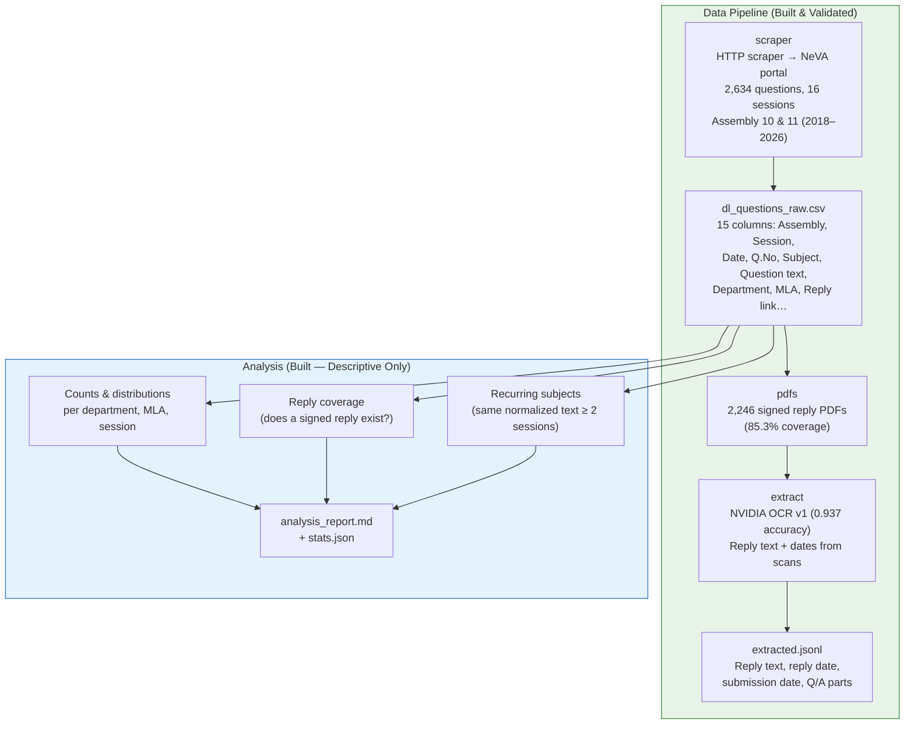
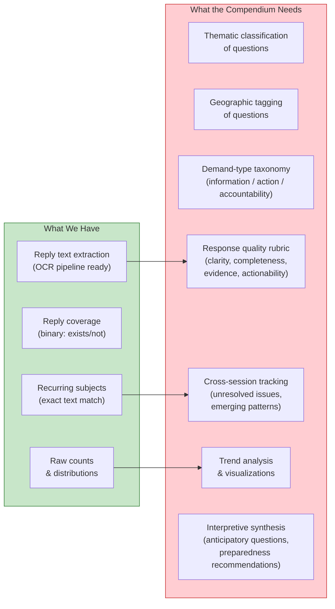
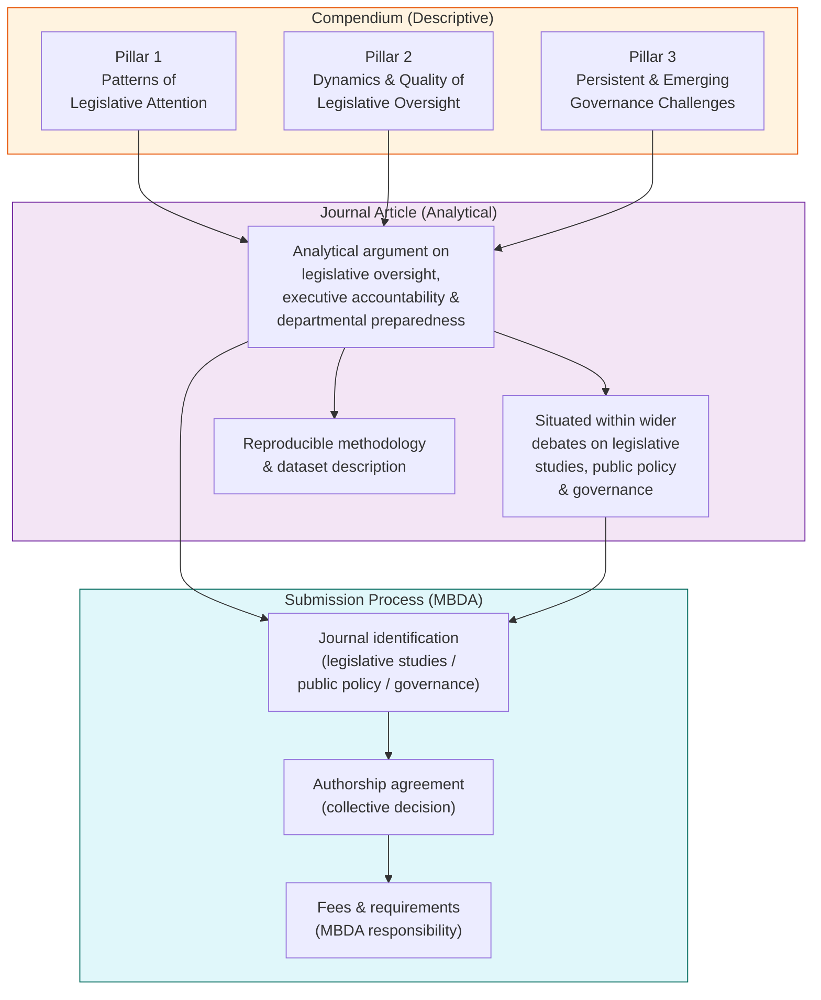
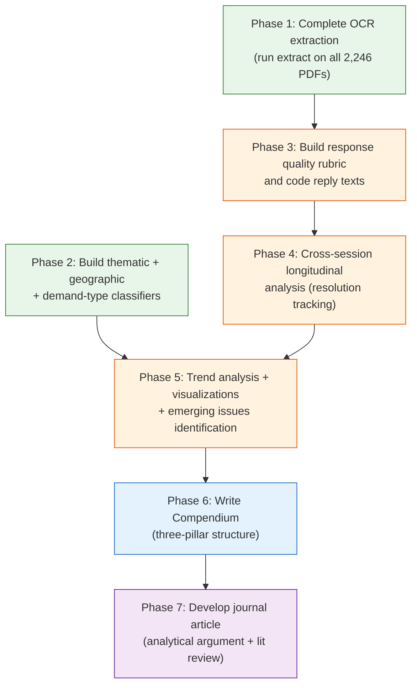

# Mental Model: Meghalaya Legislative Analysis → Compendium → Journal Article

## 1. What We Have (The Infrastructure)

### Key data facts

| Metric | Value |
|---|---|
| Total questions | 2,634 |
| Sessions | 16 (across 84 sitting dates) |
| Assemblies | 10th (2018–2022) and 11th (2023–2026) |
| Departments | 56 |
| MLAs (unique askers) | 63 |
| Starred / Unstarred | 1,945 / 689 |
| Reply PDFs available | 2,246 (85.3%) |
| Recurring subjects (exact match, ≥2 sessions) | 20+ identified |
| OCR model | NVIDIA nemotron-ocr-v1 (accuracy 0.937) |

### What the current analysis produces

The analysis package deliberately limits itself to **verifiable counts**:
- Questions per session, per department, per MLA
- Reply coverage rates (does a PDF exist)
- Recurring subjects (exact text match across sessions)
- Data quality notes (missing subjects, duplicate Q.Nos)

> [!IMPORTANT]
> The README explicitly warns against composite scores, invented probabilities, or unweighted rankings — a reaction to a previous 24k-line pipeline that produced unvalidated "readiness scores." Every number in the current output is reproducible from the input CSV.

---

## 2. What the Compendium Needs (The Three Pillars)

The Compendium requires analysis organized around **three analytical pillars**, each with specific guiding questions. Here is how each maps onto what we have and what we still need:

### Pillar 1 — Patterns of Legislative Attention

| Guiding question | Data source | Current status |
|---|---|---|
| Which departments receive the most legislative attention? | `stats.json` → departments | ✅ **Done** — ranked by question volume, share, session span |
| What policy issues and themes receive the most attention? | Subject text → thematic coding | ⚠️ **Partially done** — recurring subjects exist but need thematic grouping (health, infrastructure, education, etc.) |
| Which geographic areas receive the most attention? | Subject & question text → place-name extraction | ❌ **Not done** — requires NER or gazetteer over question/subject text |
| Which issues receive sustained attention across multiple sessions? | Recurring subjects table | ✅ **Done** (exact match) / ⚠️ Could be enriched with semantic similarity |

### Pillar 2 — Dynamics and Quality of Legislative Oversight

| Guiding question | Data source | Current status |
|---|---|---|
| What are the main types of demands being raised? | Question text → demand taxonomy | ❌ **Not done** — requires classifying questions (information requests, action demands, accountability, status updates) |
| How has legislative attention changed over time? | Session-level trends | ⚠️ **Partially done** — raw counts per session exist; need trend/shift analysis and visualization |
| How do departments respond to legislative questions? | Reply PDFs → extracted text | ⚠️ **Infrastructure exists** (OCR extraction), but no systematic coding of response patterns |
| How clear, complete and useful are the answers? | Reply text → quality assessment | ❌ **Not done** — requires a response quality rubric applied to extracted replies |
| Are answers supported by data, facts or evidence? | Reply text → evidence coding | ❌ **Not done** |
| Are there gaps, contradictions or inconsistencies? | Reply text cross-referencing | ❌ **Not done** |
| Do responses indicate clear action, timelines or follow-up? | Reply text → actionability coding | ❌ **Not done** |

### Pillar 3 — Persistent and Emerging Governance Challenges

| Guiding question | Data source | Current status |
|---|---|---|
| What governance concerns appear repeatedly? | Recurring subjects + thematic groups | ⚠️ **Partially done** — exact recurrence detected, thematic grouping needed |
| Which issues remain unresolved across sessions? | Cross-session subject tracking + reply content | ❌ **Not done** — requires linking recurring subjects to reply outcomes |
| Which departments show recurring response challenges? | Reply coverage + quality over time | ⚠️ **Partially done** — coverage tracked, quality not |
| What emerging issues are likely to receive greater attention? | Trend analysis of new subjects | ❌ **Not done** |
| What questions should departments anticipate? | Projection from patterns | ❌ **Not done** — interpretive/analytical work |
| How can departments improve preparedness? | Synthesis of all above | ❌ **Not done** — interpretive/analytical work |

---

## 3. The Gap: What Needs to Be Built

### The six analytical layers we need to add

1. **Thematic classification** — group subjects into policy domains (health, education, infrastructure, law & order, energy, water, urban, rural, governance, finance, etc.)
2. **Geographic extraction** — identify place names from questions/subjects and map to districts/constituencies
3. **Demand-type taxonomy** — classify each question by what it demands of the government (information, explanation, action, follow-up, accountability)
4. **Response quality coding** — apply a rubric to OCR-extracted reply text (clarity, completeness, evidence, actionability, timeliness)
5. **Longitudinal tracking** — link recurring subjects to their reply outcomes across sessions to assess resolution
6. **Trend and projection analysis** — identify rising/declining attention patterns and emerging concerns

> [!NOTE]
> Layers 1–3 operate on the **question side** (already in CSV). Layers 4–5 operate on the **reply side** (requires full OCR extraction run). Layer 6 is analytical synthesis built on top of all others.

---

## 4. From Compendium to Journal Article

### The article's value proposition

| Dimension | Compendium | Journal article |
|---|---|---|
| **Purpose** | Descriptive findings for practitioners | Analytical argument for scholars |
| **Audience** | MBDA, state legislature, departments | Academic community, peer reviewers |
| **Contribution** | Empirical foundation | Theoretical engagement with oversight, accountability, preparedness |
| **Method** | Counts, coverage, recurrence | Systematic coding + comparative/temporal analysis |
| **Shelf life** | Reference document | Citable, indexed, long-term |

### Possible analytical frames for the article

The Compendium's data can support arguments in several academic conversations:

1. **Information asymmetry in legislative oversight** — Do departments control the information environment through vague or incomplete replies? (Pillar 2 evidence)
2. **Legislative attention as a signal** — What does the distribution of questions reveal about legislative priorities vs. actual governance needs? (Pillar 1 evidence)
3. **Institutional learning (or its absence)** — Do departments improve their responses when the same issue recurs? (Pillar 3 evidence)
4. **Subnational legislative capacity** — How does Meghalaya compare with what we know about legislative questioning in other Indian states or small legislatures? (Comparative frame)
5. **The preparedness gap** — Can we measure the distance between what legislators ask and what executives are ready to answer? (Novel contribution)

---

## 5. Execution Sequence

> [!TIP]
> Phases 1 and 2 can run in parallel — OCR extraction is compute-bound while thematic classification operates on the existing CSV.

---

## 6. Design Principles (Carried Forward)

These principles from the current codebase should govern all new work:

1. **Every number must be reproducible from the source data** — no hand-picked weights, no unvalidated LLM clusters
2. **Don't name weighted sums "probability" or "score"** — if we build a response quality rubric, each dimension is reported separately, not collapsed into a composite
3. **Keep the question-side and reply-side analyses cleanly separated** — the question metadata (CSV) is complete and validated; the reply content (OCR) has known accuracy bounds
4. **Document every trade-off** — exact matching under-merges paraphrases but never over-merges; this is a documented choice, not a bug
5. **Facts first, interpretation second** — the Compendium reports what the data shows; the journal article adds the analytical argument on top
