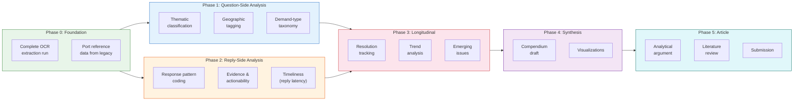
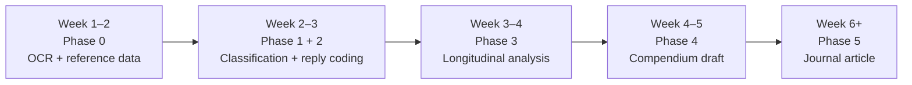

# Final Detailed Plan: Legislative Analysis Compendium & Journal Article

> **Superseded scope note (2026-10-12).** Written for the pre-restriction
> corpus (2,634 questions, 16 sessions, 2,246 reply PDFs). Delivered
> scope: sittings from 2021 — **2,217 questions, 11 sessions,
> 2,186/2,186 scoped reply PDFs** (98.6% question coverage). Corpus
> figures below are the original plan's; current numbers live in
> `docs/ARTICLE_SCAFFOLD.md` §6.

---

## Overview

This plan transforms the existing validated dataset (2,634 questions, 16 sessions, 2,246 reply PDFs) into a three-pillar Compendium and subsequently a peer-reviewed journal article. It draws on inspecting both the current clean infrastructure ([legislative-analysis](file:///d:/ISB/legislative-analysis)) and the legacy pipeline ([Legislative Preparedness](file:///d:/ISB/Legislative%20Preparedness)) — adopting what worked, discarding what didn't, and building six new analytical layers.

> [!IMPORTANT]
> **Design principle carried forward**: Every number in the Compendium must be reproducible from the source data. No composite "readiness scores", no invented probabilities. Each analytical dimension is reported separately with transparent methods.

---

## What We Inherit from the Legacy Pipeline

### ✅ Carry Forward (valuable structures and ideas)

| Asset | Legacy location | What to reuse |
|---|---|---|
| **MLA → Constituency → District → Region mapping** | `mgla_data.py` lines 500–700: `MLA_DB`, `CONSTITUENCY_DISTRICT`, `DISTRICT_REGION` | The geographic reference tables — 60 constituencies mapped to 11 districts and 3 regions. Essential for Pillar 1 geographic analysis |
| **Department normalization aliases** | `mgla_data.py` lines 170–270: `DEPT_ALIASES` | ~100 spelling/abbreviation variants mapped to canonical names. Our current normalizer is simpler |
| **Department → Sector taxonomy** | `mgla_data.py` lines 280–310: `DEPT_TAXONOMY` | Maps each department to a sector (Infrastructure, Social, Administration, etc.) |
| **Question-type "strength" taxonomy** | `mgla_charts.py` line 64: `_STRENGTH_ORDER` | The idea of classifying questions as: *Sanction Demand > Action > Justification > Information*. The legacy used LLM classification; we need a more reproducible approach |
| **Signal/evasion reply patterns** | `mgla_intelligence.py` lines 230–350: `SIGNAL_REGISTRY`, `EVASION_REGISTRY` | Regex patterns detecting assurance signals (e.g., "completed", "sanctioned") and evasion signals (e.g., "under consideration", "receiving attention"). These are the backbone of response quality coding |
| **Boilerplate/contradiction detection** | `mgla_analytics.py` lines 66–84: `_BOILERPLATE_REPLY_RE`, `_CONTRA_POS_RE`, `_CONTRA_NEG_RE` | Regex patterns for detecting boilerplate responses and contradictions (positive claim + negative qualifier). Directly feeds Pillar 2 |
| **Recurring family structure** | `recurring_families.json` | The `family_id`, `family_type` (exact/semantic), `session_history` structure. We reproduce exact families cleanly; for semantic, we need a transparent method |
| **Semantic cluster labels (LLM-generated)** | `cluster_labels_llm.json` — 140 topic labels | Good reference for a thematic dictionary / codebook (e.g., "SSA Teacher Salaries", "PMGSY Road Connections", "Eklavya Model Residential Schools") |
| **Topic hierarchy** | `topic_hierarchy.json` | 11 top-level topics with subclusters, sizes, session spans — useful as reference for building our own thematic codebook |
| **Cross-session metrics** | `cross_session_patterns.json` | `diversity_index`, `qs_per_asker` per session — reproducible metrics worth replicating |
| **Chart design system** | `mgla_config.py`: `WB_PALETTE` | World Bank–inspired color palette (navy, teal, gold, risk-red/amber/green). Professional chart styling |
| **60+ chart catalog** | `output/charts/` | Reference for which visualizations are effective — but most need redesign for the Compendium's cleaner scope |

### ❌ Discard (problematic constructs from legacy)

| Construct | Why discard |
|---|---|
| **Readiness scores** (e.g., "92/100") | Weighted sum of question volume × reply coverage × volatility — weights are arbitrary, not validated |
| **"Delivery probability"** | Unvalidated LLM-generated probability estimates |
| **Training priority scores** | Composite index from pressure × volatility × readiness — circular and unverifiable |
| **LLM-generated action plans** | Specific officer names and deadlines generated by LLM with no empirical basis |
| **"Expected next session" forecasts** | Linear extrapolation presented as prediction without backtesting |
| **Quality score (avg 70.85)** | Weighted composite of text length + specificity proxy + latency — weights untested |
| **Volatility index, pressure index** | Derived metrics with hand-tuned thresholds; never validated |
| **MLA effectiveness index** | Composite index of question volume, breadth, follow-through — weights arbitrary |

> [!CAUTION]
> The legacy pipeline's core error was collapsing multiple observable dimensions into single composite scores with arbitrary weights. The Compendium must report each dimension separately and let the reader see the evidence.

---

## The Plan: Seven Phases, Three Pillars



---

## Phase 0: Foundation (Pre-requisite)

### Task 0.1 — Complete OCR Extraction Run

| Aspect | Detail |
|---|---|
| **Goal** | Extract reply text, reply date, and submission date from all 2,246 reply PDFs |
| **Method** | Run existing `legislative_extract` pipeline (NVIDIA OCR v1 + consensus fallback) |
| **Output** | `data/extracted/extracted.jsonl` — one record per PDF with `reply`, `reply_date`, `submission_date`, `parts[]`, `needs_review[]` |
| **Effort** | ~15 hrs compute (0.4s pause × 2,246 PDFs × ~3 pages avg), fully automated |
| **Dependency** | Needs `NVIDIA_API_KEY`. Resume-friendly (skips already-extracted). |

### Task 0.2 — Port Reference Data from Legacy

| Aspect | Detail |
|---|---|
| **Goal** | Create a `reference_data.py` module with validated geographic and taxonomic lookup tables |
| **Sources** | Legacy `mgla_data.py` lines 500–700 (MLA_DB, CONSTITUENCY_DISTRICT, DISTRICT_REGION), lines 280–310 (DEPT_TAXONOMY), lines 170–270 (DEPT_ALIASES) |
| **What to port** | MLA → constituency mapping (60 entries), constituency → district (60), district → region (11→3), department → sector taxonomy (56 depts → ~10 sectors), department aliases (~100 entries) |
| **What to verify** | Cross-check against current CSV's 63 MLAs and 56 departments. Add any new names from assemblies 10 early sessions not in legacy |
| **Output** | `packages/analysis/src/legislative_analysis/reference_data.py` |

---

## Phase 1: Question-Side Analysis (Pillars 1 & 2)

### Task 1.1 — Thematic Classification

> *Feeds: Pillar 1 ("What policy issues receive the most attention?") and Pillar 3 ("What governance concerns appear repeatedly?")*

| Aspect | Detail |
|---|---|
| **Goal** | Classify each question into a policy domain and sub-domain |
| **Method** | **Dictionary-based classification** (not LLM) using a curated codebook. Build from legacy's `cluster_labels_llm.json` (140 topics) and `topic_hierarchy.json` (11 top-level categories). Each rule: keyword/phrase set → theme. Fallback: manual coding of unmatched subjects (~5–10% expected) |
| **Codebook structure** | Top-level themes (10–12): Health & Medical Services, Education & Schools, Roads & Infrastructure, Energy & Power, Water & Sanitation, Law & Order, Rural & Community Development, Urban Development, Governance & Administration, Environment & Natural Resources, Social Welfare, Economy & Commerce |
| **Sub-themes** | 2–4 per theme, e.g., Health → {PHC/CHC Facilities, Medical Staffing, Drug/Substance Abuse, Scheme Implementation} |
| **Output** | New columns in analysis: `theme`, `sub_theme` per question. Distribution tables and cross-tabs |
| **Validation** | Random sample of 100 questions manually verified. Inter-coder reliability check |
| **Legacy inspiration** | The 140 cluster labels and 11-topic hierarchy provide the seed vocabulary; but classification must be rule-based and auditable, not LLM-generated |

### Task 1.2 — Geographic Tagging

> *Feeds: Pillar 1 ("Which geographic areas receive the most attention?")*

| Aspect | Detail |
|---|---|
| **Goal** | Tag each question with constituency, district, and region where identifiable |
| **Method 1: MLA-based** | Map each `Asked_By` to their constituency/district/region using ported MLA_DB. This gives a "likely constituency" for every question |
| **Method 2: Text-based** | Scan subject + question text against a Meghalaya place-name gazetteer (district names, town names, block names). Extract explicit place mentions |
| **Gazetteer source** | Legacy `CONSTITUENCY_DISTRICT` (60 entries), `DISTRICT_REGION` (11 entries), plus Wikipedia list of towns/blocks in Meghalaya |
| **Output** | Columns: `mla_constituency`, `mla_district`, `mla_region`, `mentioned_places[]`, `mentioned_districts[]` |
| **Visualization** | District-level heatmap of legislative attention; constituency-level bar charts |
| **Known limitation** | MLA-based mapping assumes questions relate to the MLA's constituency — true for most constituency-specific questions but not for state-wide policy questions. Document this |

### Task 1.3 — Demand-Type Taxonomy

> *Feeds: Pillar 2 ("What are the main types of demands being raised?")*

| Aspect | Detail |
|---|---|
| **Goal** | Classify each question by what it demands of the government |
| **Taxonomy** | Four types (adapted from legacy's `_STRENGTH_ORDER` but renamed for neutrality): |
| | **1. Information Request** — "How many…?", "What is the status of…?" |
| | **2. Explanation/Justification** — "Why has…?", "What are the reasons…?" |
| | **3. Action Demand** — "Whether the government will…?", "What steps are being taken…?" |
| | **4. Accountability/Follow-up** — Re-raised issue, asking about prior commitments |
| **Method** | Rule-based keyword classification from question text. The `Questions` column contains the full text. Pattern examples: "how many" / "total number" → Information; "why" / "reasons for" → Explanation; "whether.*will" / "steps.*taken" → Action; re-raised subject (from recurring detection) → Accountability |
| **Output** | Column: `demand_type` per question. Cross-tabs by department, session, theme |
| **Legacy comparison** | Legacy used LLM to classify "strength" (Sanction Demand / Action / Justification / Information / Unclassified). Our taxonomy is similar but rule-based and auditable |

---

## Phase 2: Reply-Side Analysis (Pillar 2)

> [!NOTE]
> Phase 2 depends on Task 0.1 (OCR extraction). Can begin in parallel for the ~2,246 PDFs already downloaded.

### Task 2.1 — Response Pattern Coding

> *Feeds: Pillar 2 ("How do departments respond?", "How clear and useful are the answers?")*

| Aspect | Detail |
|---|---|
| **Goal** | Code each reply along four observable dimensions (not collapsed into a single score) |
| **Dimensions** | |
| | **A. Substantiveness** — text length as proxy for detail: Brief (<200 chars) / Standard (200–500) / Detailed (500–1500) / Very Detailed (>1500). Ported from legacy `pdf_size_indicator` but applied to extracted text |
| | **B. Specificity** — does the reply contain specific data points? Count of: numbers/statistics, dates/deadlines, named schemes/programmes, budget figures. Categories: High (3+ data points) / Medium (1–2) / Low (0) |
| | **C. Assurance vs. Evasion** — regex-based detection ported from legacy `SIGNAL_REGISTRY` and `EVASION_REGISTRY`: |
| | — *Assurance signals*: "completed", "sanctioned", "allocated", "Rs. X crore released" |
| | — *Evasion signals*: "under consideration", "receiving attention", "at the earliest", "necessary steps will be taken" |
| | — Report as counts, not scores: "3 assurance signals, 1 evasion signal" |
| | **D. Actionability** — does the reply commit to specific action? Detect: named timelines ("by March 2026"), named responsible parties ("the DC has been directed"), budget amounts ("Rs. 5.2 crore sanctioned"). Binary per sub-type |
| **Method** | All regex-based. Port and clean the legacy regex registries (~40 assurance patterns, ~30 evasion patterns, ~15 boilerplate patterns) |
| **Output** | Per-reply record: `{substantiveness, specificity_score, assurance_count, evasion_count, boilerplate_count, has_timeline, has_budget, has_responsible_party}`. Aggregate by department |

### Task 2.2 — Evidence and Contradiction Detection

> *Feeds: Pillar 2 ("Are answers supported by data?", "Are there gaps or contradictions?")*

| Aspect | Detail |
|---|---|
| **Goal** | Detect replies that contain contradictions or are purely boilerplate |
| **Method** | Port legacy `_CONTRA_POS_RE` and `_CONTRA_NEG_RE` patterns. A reply is "contradictory" when it contains both a positive claim ("completed", "sanctioned") and a negation ("not yet", "pending", "no funds") for the same subject within the same paragraph |
| **Boilerplate detection** | Port `_BOILERPLATE_REPLY_RE`. Flag replies that consist primarily of stock phrases with no specific content |
| **Output** | Flags: `has_contradiction`, `is_boilerplate`, `evidence_types[]` (statistics, scheme names, dates, budget figures). Department-level aggregates |

### Task 2.3 — Reply Timeliness

> *Feeds: Pillar 2 ("How has attention changed over time?")*

| Aspect | Detail |
|---|---|
| **Goal** | Measure response latency where determinable |
| **Data** | `submission_date` (when notice was received) and `reply_date` (when reply was issued) from OCR extraction |
| **Metric** | Days between submission and reply date. Report as: median, 75th percentile, share >30 days |
| **Known gaps** | Legacy had `latency_samples: 0` — dates were hard to extract. Our OCR pipeline + consensus should do better. Report the coverage rate (% of PDFs where both dates were successfully extracted) |
| **Output** | Per-department latency distributions. Session-level trends |

---

## Phase 3: Longitudinal Analysis (Pillar 3)

### Task 3.1 — Resolution Tracking

> *Feeds: Pillar 3 ("Which issues remain unresolved across sessions?")*

| Aspect | Detail |
|---|---|
| **Goal** | For each recurring subject, track whether the government's response evolved across sessions |
| **Method** | For each recurring family (same subject ≥ 2 sessions), extract and compare reply texts across sessions. Code the trajectory: |
| | — **Resolved**: later reply contains completion language ("completed", "operational") |
| | — **Progressing**: later reply shows measurable progress ("50% completed", "funds released") |
| | — **Stalled**: later reply uses same boilerplate as earlier reply |
| | — **Regressed**: later reply shows new problems on previously claimed progress |
| **Data** | Requires extracted reply text from Task 0.1 + recurring families from current analysis |
| **Output** | Per-family resolution status. Department-level resolution rates. "Stalled issues" list for Pillar 3 |

### Task 3.2 — Trend Analysis

> *Feeds: Pillar 2 ("How has legislative attention changed?") and Pillar 3 ("What emerging issues?")*

| Aspect | Detail |
|---|---|
| **Goal** | Identify rising, declining, and emerging patterns in legislative attention |
| **Metrics** | |
| | — **Department attention trends**: questions per department per session, session-over-session change |
| | — **Theme trends**: questions per theme per session (requires Task 1.1) |
| | — **New vs. recurring ratio**: share of questions on previously-raised subjects per session |
| | — **Diversity index**: departments per MLA per session (from legacy `cross_session_patterns.json` — reproducible) |
| | — **Starred vs. unstarred trends**: ratio shifts over time |
| **Visualization** | Line charts with slopes, heatmaps of department × session attention |
| **Output** | Trend tables, slope analysis, "rising issues" and "declining issues" lists |

### Task 3.3 — Emerging Issues Identification

> *Feeds: Pillar 3 ("What emerging issues?", "What should departments anticipate?")*

| Aspect | Detail |
|---|---|
| **Goal** | Identify subjects that appeared for the first time in recent sessions and show signs of becoming recurring |
| **Method** | Flag subjects that: (a) first appeared in the last 2–3 sessions, AND (b) have ≥2 occurrences, AND (c) are asked by multiple MLAs (broader concern, not individual agenda) |
| **Output** | "Emerging issues watchlist" with first-appearance session, occurrence count, number of distinct askers |

---

## Phase 4: Compendium Synthesis

### Task 4.1 — Compendium Document Structure

```
COMPENDIUM: Legislative Oversight in Meghalaya
═══════════════════════════════════════════════

Executive Summary
  - Key findings (1 page)
  - Data overview

Part I: Patterns of Legislative Attention
  Ch 1. Departmental attention landscape
     - Question volume rankings
     - Session span (how many sessions a dept faces questions)
     - Asker breadth (how many MLAs question each dept)
  Ch 2. Thematic attention
     - Policy domain distribution
     - Theme × department cross-tabulation
     - Starred vs. unstarred by theme
  Ch 3. Geographic attention
     - District/region-level attention maps
     - Constituency-specific vs. state-wide questions
  Ch 4. Sustained attention
     - Recurring subjects catalog
     - Cross-session persistence patterns

Part II: Dynamics and Quality of Legislative Oversight
  Ch 5. Demand types
     - Distribution of information / explanation / action / accountability demands
     - Demand type × department patterns
  Ch 6. Trends over time
     - Session-level volume trends
     - Rising and declining departments
     - New vs. recurring question ratios
  Ch 7. Response quality
     - Substantiveness distributions by department
     - Specificity analysis
     - Assurance vs. evasion patterns by department
     - Boilerplate detection results
     - Timeliness (where data available)
  Ch 8. Gaps and contradictions
     - Contradiction detection results
     - Evidence gaps by department
     - Actionability analysis

Part III: Persistent and Emerging Governance Challenges
  Ch 9. Unresolved issues
     - Resolution tracking results
     - "Stalled issues" catalog
     - Departments with lowest resolution rates
  Ch 10. Recurring challenges
     - Issues that persist across both assemblies
     - Departments with structural response difficulties
  Ch 11. Emerging issues and anticipation
     - Emerging issues watchlist
     - Anticipatory analysis by department
     - Preparedness recommendations (evidence-based)

Methodology Appendix
  - Data sources and pipeline description
  - Classification codebooks (themes, demand types)
  - Validation results
  - Limitations and caveats

Data Appendix
  - Full department rankings table
  - Full MLA activity table
  - Full recurring subjects catalog
  - Session-level statistics
```

### Task 4.2 — Visualization Plan

| # | Chart | Pillar | Data source |
|---|---|---|---|
| 1 | Department attention bar chart (top 20, with share %) | P1 | Current stats.json |
| 2 | Department × session heatmap (question volume) | P1/P2 | Current + trend analysis |
| 3 | Thematic treemap / bar chart | P1 | Task 1.1 |
| 4 | District attention choropleth (Meghalaya map) | P1 | Task 1.2 |
| 5 | Recurring subjects × session matrix (dot plot) | P1 | Current recurring detection |
| 6 | Demand-type stacked bar by department | P2 | Task 1.3 |
| 7 | Session volume trend line (with assembly transition) | P2 | Current + trend |
| 8 | Department trend slopes (rising/declining) | P2 | Task 3.2 |
| 9 | Response substantiveness distribution by department | P2 | Task 2.1 |
| 10 | Assurance vs. evasion scatter by department | P2 | Task 2.1 |
| 11 | Reply coverage waterfall (improving over time) | P2 | Current data |
| 12 | Resolution tracking Sankey (recurring → resolved/stalled) | P3 | Task 3.1 |
| 13 | Emerging issues timeline | P3 | Task 3.3 |
| 14 | Starred vs. unstarred ratio trend | P2 | Current data |
| 15 | MLA activity bubble chart (questions × breadth × top dept) | P1 | Current stats.json |

**Chart design**: Use legacy's World Bank–inspired palette (`WB_PALETTE` from `mgla_config.py`). Professional, print-ready, grayscale-compatible.

---

## Phase 5: Journal Article

### Analytical Argument Options (to be decided collectively)

| Frame | Core argument | Primary evidence |
|---|---|---|
| **A. The Information Asymmetry Frame** | Departments systematically control the information environment through vague, boilerplate, or evasive replies, undermining the legislature's oversight function | Pillar 2: evasion/assurance patterns, boilerplate rates, specificity gaps |
| **B. The Institutional Learning Frame** | Legislative questioning creates a feedback loop that can improve governance — but only when departments engage substantively. Measure whether repeated questioning on the same issue produces better responses over time | Pillar 3: resolution tracking, response evolution across sessions |
| **C. The Legislative Attention Frame** | The distribution of legislative questions reveals systematic attention biases — some departments face disproportionate scrutiny while others operate with minimal oversight. What drives this allocation? | Pillar 1: attention concentration, demand-type patterns, MLA behavior |
| **D. The Preparedness Gap Frame** (most novel) | Develop a measurable concept of "departmental preparedness" — the distance between what legislators ask and what executives are ready to answer — without collapsing it into a single score. Show how this gap varies across departments and over time | All three pillars |

### Candidate Journals

| Journal | Fit | IF | Notes |
|---|---|---|---|
| *The Journal of Legislative Studies* | ★★★★★ | 1.8 | Directly on point — legislative questioning, oversight |
| *Public Administration* | ★★★★ | 4.6 | Executive-legislative dynamics, accountability |
| *Commonwealth & Comparative Politics* | ★★★★ | 2.1 | Subnational governance, developing democracies |
| *Indian Journal of Public Administration* | ★★★★ | — | Indian context, state-level governance |
| *The Journal of Development Studies* | ★★★ | 3.9 | If framed around governance and development |
| *Governance* | ★★★★ | 3.3 | Institutional design, accountability mechanisms |
| *Parliamentary Affairs* | ★★★★★ | 1.5 | Parliamentary procedure, questions, oversight |

### Journal Article Structure (Draft)

```
1. Introduction
   - Legislative questioning as oversight mechanism
   - The puzzle: does questioning improve governance?
   - The Meghalaya case

2. Legislative Oversight and Executive Accountability: Literature
   - Question time as information extraction
   - Subnational legislative capacity in India
   - Response quality and institutional learning

3. Data and Methods
   - The Meghalaya legislative questions dataset
   - Classification methodology
   - Response quality coding framework
   - Limitations

4. Findings
   4.1 Patterns of attention (from Pillar 1)
   4.2 Response quality and evasion (from Pillar 2)
   4.3 Resolution and institutional learning (from Pillar 3)

5. Discussion
   - [Analytical argument from chosen frame]
   - Implications for legislative reform
   - Implications for departmental practice

6. Conclusion

Appendix: Codebooks, validation, replication materials
```

---

## Execution Timeline

| Phase | Tasks | Parallel? | Estimated effort | Dependencies |
|---|---|---|---|---|
| **Phase 0** | OCR extraction + port reference data | Yes (can run in parallel) | OCR: ~15 hrs compute; Porting: 1 day coding | NVIDIA_API_KEY |
| **Phase 1** | Thematic + geographic + demand-type | All three in parallel | 3–5 days | Phase 0 (reference data) |
| **Phase 2** | Response patterns + evidence + timeliness | All three in parallel | 3–5 days | Phase 0 (OCR extraction) |
| **Phase 3** | Resolution + trends + emerging | Sequential (3.1 needs 2.1; 3.2 needs 1.1) | 3–4 days | Phases 1 & 2 |
| **Phase 4** | Compendium draft + visualizations | Parallel | 5–7 days | Phase 3 |
| **Phase 5** | Article development + submission | Sequential | 4–8 weeks | Phase 4 + collective decisions on framing, authorship |



---

## Decisions Needed

1. **Thematic codebook**: Should we start with the 11 categories from the legacy `topic_hierarchy.json`, or develop a fresh taxonomy? The legacy categories are: General/Other, Health Services, Education & Schools, Roads & Infrastructure, Energy & Power, Water & Sanitation, Law & Order, Rural Development, Urban Development, Environment, Social Welfare.

2. **Demand-type classification**: The four-type taxonomy (Information / Explanation / Action / Accountability) — is this the right granularity, or do we need more/fewer categories?

3. **Semantic recurring detection**: The current system does exact-match only (documented trade-off). Should we add fuzzy/semantic matching for the Compendium, knowing it risks over-merging? Or keep exact-only and document the under-merge?

4. **Journal article frame**: Which of the four analytical frames (A–D above) should we develop? This affects which findings we emphasize.

5. **Authorship and journal selection**: To be discussed collectively per the MBDA agreement.
